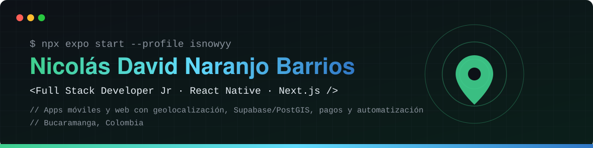

 

<!--  -->

---

### 01 · Sobre mí

Desarrollador **Full Stack Junior** enfocado en **React Native (Expo), Next.js y TypeScript**. Soy fundador y programador principal de **Wayrex**, una plataforma de servicios basada en geolocalización que conecta a las personas con negocios y proveedores cercanos. Me encargo del producto completo: app móvil, web, base de datos geoespacial, pagos y automatizaciones.

Trabajo como **desarrollador de software junior en Lean Solutions Group**, hago proyectos freelance desde junio de 2026 y me formo en desarrollo de software en **Campuslands**.

Me caracterizo por la **autonomía para llevar un producto de la idea a producción, la resolución de problemas, el aprendizaje rápido y el trabajo en equipo**.

---

### 02 · Tecnologías y habilidades

**Mobile y frontend**

**Backend y bases de datos**

**Pagos, automatización y herramientas**

---

### 03 · Proyectos destacados

<table>
<tr>
<td width="50%" valign="top">

#### Wayrex

Plataforma de servicios basada en geolocalización: mapa de negocios y proveedores cercanos, roles (usuario, VIP y negocio), búsqueda en el mapa y pagos en línea.

**Tecnologías**

     

**Aporte**

Fundador y desarrollador principal: arquitectura, app móvil, web, base de datos geoespacial, pagos y automatizaciones.

**Enlaces**

[Ver en el portafolio](https://mi-portafolio-kappa-seven.vercel.app/)

</td>
<td width="50%" valign="top">

#### Hackatón Campuslands

Sistema Central de Gestión Operativa del Campus (MVP): gestión de espacios, recursos tecnológicos e incidencias con triaje mediante IA.

**Tecnologías**

 

**Aporte**

Desarrollo del MVP en el hackatón.

**Enlaces**

[Ver repositorio](https://github.com/isnowyy/hackaton-campuslands)

</td>
</tr>
<tr>
<td width="50%" valign="top">

#### CrediYa

Sistema de cobro de cartera en consola para CrediYa S.A.S., con POO, principios SOLID, patrones de diseño, JDBC/MySQL y persistencia en archivos.

**Tecnologías**

   

**Aporte**

Diseño y desarrollo completo del sistema.

**Enlaces**

[Ver repositorio](https://github.com/isnowyy/crediya)

</td>
<td width="50%" valign="top">

#### Clasificador de tostado de café

Clasificador del nivel de tostado de café en tiempo real con la cámara, entrenado con Teachable Machine y ejecutado en el navegador.

**Tecnologías**

  

**Aporte**

Entrenamiento del modelo e integración web.

**Enlaces**

[Ver repositorio](https://github.com/isnowyy/clasificador-tostado-cafe)

</td>
</tr>
</table>

---

### 04 · Experiencia profesional

#### Desarrollador de Software Junior
**Lean Solutions Group** · Contrato de aprendizaje 
**Febrero 2026 – Presente**

#### Fundador y Desarrollador Full Stack
**Wayrex** · Bucaramanga, Santander 
**Junio 2026 – Presente**

- Desarrollo de la app móvil con **React Native (Expo)** y la web con **Next.js + TypeScript**.
- Modelado de datos geoespaciales con **Supabase + PostGIS** para búsquedas por cercanía.
- Integración de pagos con **Wompi** y automatizaciones con **n8n**.
- Preparación de publicación en App Store y Play Store con **EAS Build**, política de privacidad y términos (Ley 1581 de 2012).

#### Desarrollador Freelance
**Independiente** 
**Junio 2026 – Presente**

- Desarrollo de aplicaciones web y móviles para clientes, de la idea a producción.

---

### 05 · Formación

#### Desarrollo de Software — Campuslands
**2026 – Presente** 
Formación intensiva en desarrollo de software full stack.

#### Ingeniería Metalúrgica — Universidad Industrial de Santander (UIS)
**2023 – Presente** · Bucaramanga, Santander

<!--
### 06 · Certificaciones

- **Nombre del curso** · Entidad · Mes Año
-->

---

### 06 · Idiomas

- **Español:** Nativo
- **Inglés:** A2 (en formación)

---

### 07 · Estadísticas de GitHub

---

### 08 · Contacto

**Bucaramanga, Santander, Colombia** 
**LinkedIn:** [linkedin.com/in/nicolas-naranjo-0b8720257](https://www.linkedin.com/in/nicolas-naranjo-0b8720257) 
**Portafolio:** [mi-portafolio-kappa-seven.vercel.app](https://mi-portafolio-kappa-seven.vercel.app/) 
**GitHub:** [github.com/isnowyy](https://github.com/isnowyy)
<!-- **Correo:** [TU_CORREO](mailto:TU_CORREO) -->

<!--
#### Hoja de vida

-->
